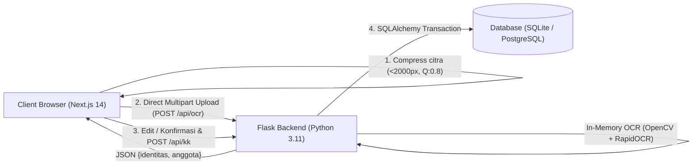

# KK-SCANNER PRO: Sistem Ekstraksi OCR & Validasi Kartu Keluarga

Aplikasi Web Full-Stack modern untuk memindai, mengekstraksi, memvalidasi struktur 16-digit, dan mengelola dokumen **Kartu Keluarga (KK) Republik Indonesia**.

Sistem ini menggunakan **Python computer vision pipeline** (OpenCV + RapidOCR ONNX CPU Engine / Tesseract OCR + RapidFuzz) **100% lokal tanpa API LLM / Cloud OCR berbayar**, dirancang ringan dan hemat memori (< 512 MB RAM).

---

## 1. Arsitektur & Tech Stack



- **Frontend**: Next.js 14 (App Router, TypeScript Strict, Tailwind CSS).
  - Desain antarmuka bersih, elegan, dan anti-slop dengan tipografi seragam **Google Font Ubuntu**.
  - Menggunakan icon SVG murni (tanpa emotikon / simbol teks).
  - Tampilan beranda terpusat (Hero + Upload Box), dengan pratinjau lembar interaktif yang muncul tepat di bawah kotak setelah berkas dipilih/dipindai.
  - Dua menu navigasi: **Beranda** (`/`) dan **Data Tersimpan** (`/kk`).
  - Dilengkapi Interactive KK Sheet Facsimile, dekoder struktur 16-digit NIK, dan sistem notifikasi toast.
- **Backend**: Python 3.11, Flask, Flask-SQLAlchemy, Flask-CORS, Gunicorn.
  - OCR Engine: **RapidOCR (ONNX CPU Runtime, 100% offline & cepat)** dengan fallback ke **Tesseract OCR (Bahasa Indonesia `ind`)**.
  - Prapemrosesan citra: OpenCV Headless (CLAHE contrast enhancement, cubic upscaling, binarize, deskew).
  - Penguraian data: RapidFuzz & RegEx parser untuk validasi NIK, tanggal, dan pencocokan wilayah/status.
  - Pemrosesan ramah memori (in-memory processing, `del` + `gc.collect()`).
- **Database**:
  - **Lokal (Default)**: SQLite (`backend/kk.db`) otomatis aktif tanpa setup tambahan.
  - **Produksi / Cloud**: PostgreSQL di Supabase (via connection pooler IPv4 port 6543/5432).

---

## 2. Struktur Folder Proyek

```text
kartukeluarga/
├── README.md                        # Dokumentasi lengkap
├── .gitignore                       # Aturan ignore git
├── backend/
│   ├── Dockerfile                   # Docker image untuk deployment (Render)
│   ├── .dockerignore
│   ├── requirements.txt             # Dependensi Python
│   ├── .env.example                 # Template environment variable backend
│   ├── app.py                       # Application factory, CORS, CLI init-db
│   ├── config.py                    # Konfigurasi SQLAlchemy, CORS, batas upload
│   ├── models.py                    # Model ORM tbl_identitasKK & tbl_anggotaKeluargaKK
│   ├── schema.sql                   # File DDL SQL PostgreSQL murni + RLS
│   ├── ocr_cli.py                   # Script CLI mandiri untuk menguji gambar
│   ├── contoh.jpeg                  # Contoh citra KK untuk pengujian
│   ├── schemas/
│   │   ├── __init__.py
│   │   └── validators.py            # Validasi 16-digit angka, tanggal ISO, mandatory fields
│   ├── routes/
│   │   ├── __init__.py
│   │   ├── ocr.py                   # /api/health dan /api/ocr
│   │   ├── kk.py                    # /api/kk CRUD (Atomic transaction & search)
│   │   └── anggota.py               # /api/kk/<id>/anggota & /api/anggota/<id>
│   └── services/
│       ├── __init__.py
│       ├── constants.py             # Lookup enumerasi Agama, Pendidikan, Relasi, dll.
│       ├── layout_parser.py         # Ekstraksi spasial koordinat kolom & baris KK
│       ├── preprocessing.py         # Decode bytes, resize, CLAHE, upscaling
│       ├── parsing.py               # Pembersihan 16-digit, dekoder NIK, rapidfuzz
│       └── ocr_service.py           # Orkestrasi RapidOCR & Tesseract pipeline
└── frontend/
    ├── package.json
    ├── tsconfig.json                # TypeScript strict mode
    ├── tailwind.config.ts           # Konfigurasi Tailwind & Google Font Ubuntu
    ├── postcss.config.mjs
    ├── next.config.mjs
    ├── types.ts                     # Strict TypeScript interfaces
    ├── .env.example                 # Template environment variable frontend
    ├── public/
    │   └── contoh.jpeg              # Citra contoh untuk frontend
    ├── lib/
    │   ├── api.ts                   # Modul terpusat seluruh pemanggilan REST API
    │   └── utils.ts                 # Kompresi canvas client & dekoder NIK
    ├── components/
    │   ├── Navbar.tsx               # Header navigasi 2 menu & theme toggle
    │   ├── Toast.tsx                # Toast notifikasi responsif dengan icon SVG
    │   ├── InteractiveKkSheet.tsx   # Facsimile lembar KK & pratinjau dokumen
    │   ├── EditIdentitasModal.tsx   # Dialog modal edit kepala keluarga/alamat
    │   ├── EditMemberModal.tsx      # Dialog modal edit/tambah anggota keluarga
    │   └── ConfirmDeleteModal.tsx   # Dialog konfirmasi hapus data
    └── app/
        ├── layout.tsx               # Root layout dengan Google Font Ubuntu
        ├── globals.css              # Design system & variabel CSS
        ├── page.tsx                 # Halaman utama (Hero + Upload + Preview bawah)
        ├── konfirmasi/
        │   └── page.tsx             # Halaman verifikasi & koreksi formulir
        └── kk/
            ├── page.tsx             # Halaman tabel pencarian KK tersimpan
            └── [id]/
                └── page.tsx         # Halaman rincian detail identitas & anggota KK
```

---

## 3. Panduan Jalankan Lokal

### Prasyarat
- **Python**: Versi 3.10 atau 3.11/3.12.
- **Node.js**: Versi 18 atau 20 LTS.
- **Tesseract OCR (Opsional)**: Jika ingin fallback sekunder selain RapidOCR ONNX.

---

### Langkah A: Menjalankan Backend Python (Port 5000)

1. Masuk ke direktori `backend`:
   ```bash
   cd backend
   ```

2. Buat dan aktifkan virtual environment:
   ```bash
   # Windows PowerShell:
   python -m venv venv
   .\venv\Scripts\Activate.ps1

   # Linux / macOS:
   python3 -m venv venv
   source venv/bin/activate
   ```

3. Instal dependensi:
   ```bash
   pip install -r requirements.txt
   ```

4. *(Opsional)* Salin `.env.example` ke `.env`:
   ```bash
   cp .env.example .env
   ```
   *Catatan: Jika `DATABASE_URL` tidak diisi, backend otomatis menggunakan SQLite lokal (`kk.db`).*

5. Inisialisasi tabel database lokal:
   ```bash
   flask init-db
   ```

6. Jalankan server Flask:
   ```bash
   python app.py
   ```
   Backend berjalan di: `http://localhost:5000` (Health check: `http://localhost:5000/api/health`).

---

### Langkah B: Pengujian Cepat via CLI Python

Anda dapat menguji pembacaan gambar secara langsung tanpa membuka browser:
```bash
python ocr_cli.py contoh.jpeg
```
Output akan langsung mencetak JSON hasil ekstraksi identitas KK dan seluruh anggota keluarga.

---

### Langkah C: Menjalankan Frontend Next.js (Port 3000)

1. Buka terminal baru dan masuk ke direktori `frontend`:
   ```bash
   cd frontend
   ```

2. Instal dependensi Node.js:
   ```bash
   npm install
   ```

3. Jalankan server pengembang:
   ```bash
   npm run dev
   ```
   Aplikasi dapat diakses di browser melalui: `http://localhost:3000`.

---

## 4. Skema Database

Tabel PostgreSQL/SQLite:
- **`tbl_identitasKK`**: Menyimpan nomor KK (16 digit unik), nama kepala keluarga, alamat, RT/RW, desa/kelurahan, kecamatan, kabupaten/kota, provinsi, kode pos, dan tanggal dikeluarkan.
- **`tbl_anggotaKeluargaKK`**: Menyimpan relasi anggota (FK `id_kk` ke `tbl_identitasKK.id` dengan `ON DELETE CASCADE`), nomor urut, NIK (16 digit), nama lengkap, jenis kelamin, tempat & tanggal lahir, agama, pendidikan, pekerjaan, status perkawinan, hubungan keluarga, kewarganegaraan, serta nama ayah dan ibu.

---

## 5. Ringkasan Endpoint REST API

| Metode | Endpoint | Deskripsi |
|---|---|---|
| `GET` | `/api/health` | Ping server & cek uptime backend |
| `POST` | `/api/ocr` | Menerima berkas gambar multipart, memproses OCR lokal, mengembalikan JSON hasil |
| `POST` | `/api/kk` | Menyimpan identitas KK dan daftar anggota dalam satu transaksi atomik |
| `GET` | `/api/kk?q=&page=&per_page=` | Menampilkan daftar KK tersimpan dengan pagination dan pencarian |
| `GET` | `/api/kk/<id>` | Mengambil detail lengkap KK dan daftar anggotanya |
| `PUT` | `/api/kk/<id>` | Memperbarui data identitas KK |
| `DELETE` | `/api/kk/<id>` | Menghapus KK beserta seluruh data anggotanya secara bertingkat (cascade) |
| `POST` | `/api/kk/<id>/anggota` | Menambahkan anggota keluarga baru pada KK |
| `PUT` | `/api/anggota/<id>` | Memperbarui biodata seorang anggota |
| `DELETE` | `/api/anggota/<id>` | Menghapus seorang anggota dari KK |
